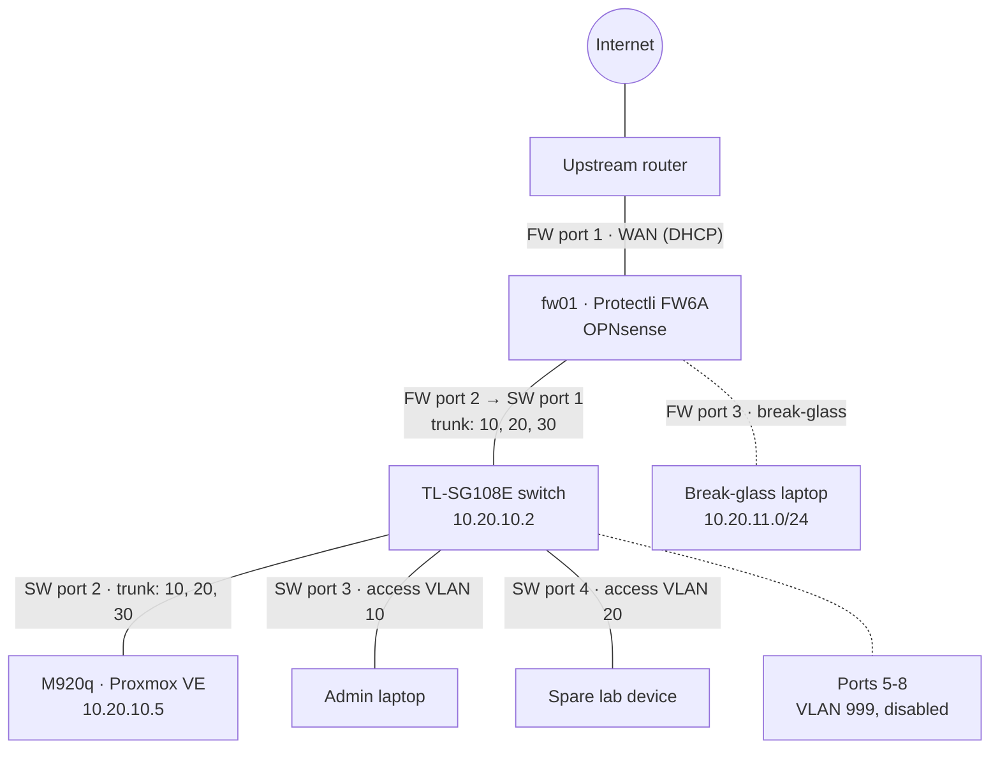
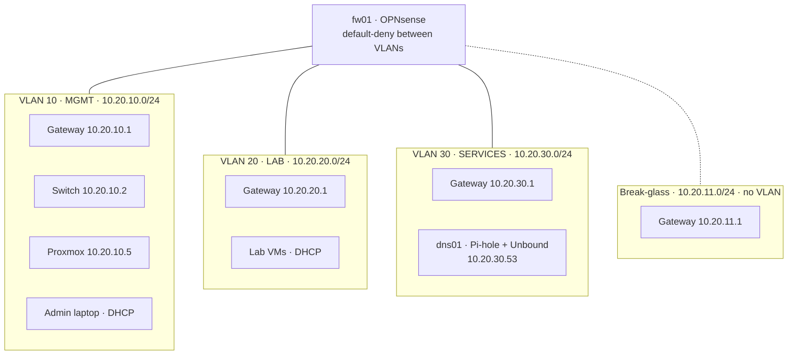

# Phase 0 topology

## Physical

How the hardware is cabled. Port numbers are switch ports on the TL-SG108E and physical ports on the FW6A.

## Logical

The VLANs, their gateways on the firewall, and what lives in each one. Traffic between VLANs is denied unless a rule allows it.

Every /24 uses the same layout: .1 gateway, .2-.9 network devices, .10-.99 static servers, .100-.199 DHCP.
